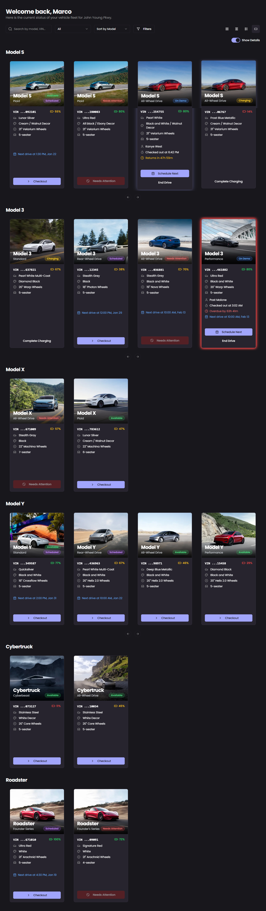
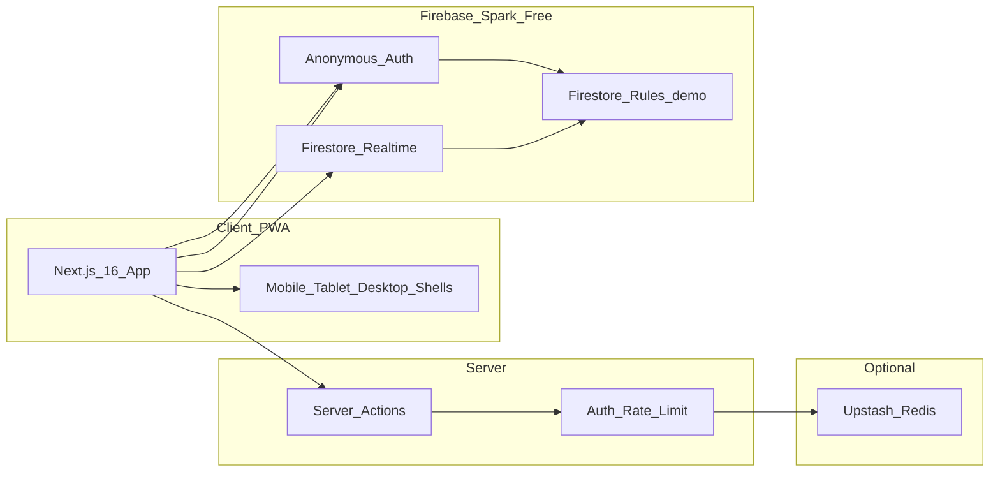

# Demo Drive Hub

**Real-time EV demo fleet management for retail showrooms** — built, designed, and deployed as an independent portfolio project by [Marco Serrano](https://www.linkedin.com/in/marco-serrano25/).

> **Independent portfolio project.** Not affiliated with or endorsed by Tesla, Inc. or any automotive manufacturer. Built to demonstrate full-stack product design for EV retail demo fleet operations.

[](https://nextjs.org/)
[](https://www.typescriptlang.org/)
[](https://firebase.google.com/)
[](https://web.dev/progressive-web-apps/)

**[Live Demo](#)** · **[Walkthrough](https://player.vimeo.com/video/1165516041)** · **[About](/about)** · **[GitHub](https://github.com/marcoserrano21)** · **[LinkedIn](https://www.linkedin.com/in/marco-serrano25/)**

---

## The Problem

Demo drives are the peak moment on the showroom floor — but teams often track fleet availability on whiteboards, group chats, and memory.

The breaking point: an advisor walked between a customer, a whiteboard, and a group chat just to confirm vehicle availability. **It took 25 minutes.** The customer waited. The store lost momentum.

We assumed demo drives took **30 minutes**. Pilot data showed they actually averaged **57 minutes** — a hidden 27-minute leak that drove scheduling chaos, longer waits, and missed opportunities at peak excitement.

| Pain point | Reality |
|---|---|
| Availability checks | 5–8 minutes per drive; advisors leaving customers mid-conversation |
| Data capture | Whiteboards erased daily; group-chat photos buried in minutes |
| Insight | No analytics, no conversion tracking, no fleet-wide visibility |
| Customer impact | 15–30 minute waits during rush hour |

---

## The Solution

**Demo Drive Hub** is a mobile-first PWA that consolidates check-in/check-out, live fleet visibility, advisor gamification, demo-to-sale analytics, and manager dashboards into one system — designed around three principles:

1. **Speed** — Confirm availability in seconds. Check-in/out in under 30 seconds.
2. **Simplicity** — Color-coded fleet status (Available · Charging · On Demo · Needs Attention) readable at a glance.
3. **Intelligence** — Structured data, keyword-based issue flagging, and analytics that surface patterns invisible in manual workflows.



---

## Key Features

### Live Fleet Dashboard
Real-time vehicle status, battery level, expected return times, overdue alerts, and assigned advisor — with quick actions for checkout, end drive, and schedule next. Four fleet views: **grid, compact, list, and carousel**.

### Digital Check-In / Check-Out
A ~30-second workflow replacing 5+ minutes of manual steps. Captures advisor, VIN/model, battery (visual picker), duration, star ratings, feedback, and **demo-to-sale conversion** (model/trim tracking). Firestore transactions prevent double-bookings.

### Keyword Issue Detection
Maintenance issues flagged via **keyword-based pattern matching** on advisor feedback — rattles, scratches, warning lights, charge-port faults, and more. No paid AI required; single source of truth in `src/lib/issue-keywords.ts`.

### Demo-to-Sale Analytics
Track which models and trims convert after demos. Per-advisor conversion rates, purchase breakdowns by model/trim, and Copilot-of-the-Month recognition for managers.

### Custom Chart Builder
14 pre-built analytics presets plus a Power BI–style chart builder with **PNG, JPG, and PDF export** — managers answer operational questions without waiting for reports.

### Gamification
- **50 achievements** across 7 categories
- **99-level XP system** with rank tiers, streaks, and level-up celebrations
- Hall of Fame leaderboard, manual manager awards, and store/advisor goals

### Schedule & Operations
Calendar and table views for upcoming drives. Manager-gated **auto check-in** (off by default, server-validated). Vehicle sold workflow and issue resolution dialog.

### My Hub
Personal advisor dashboard — badges, sentiment summary, conversion stats, and progression at a glance.

### Role-Based Access Control

| Role | Capabilities |
|---|---|
| **Advisor** | View fleet, check vehicles in/out, manage personal stats |
| **Moderator** | Review check-ins/outs, resolve flagged issues, maintain data accuracy |
| **Manager** | Full admin panel, analytics, user management, goals, awards, fleet CRUD |

### Progressive Web App
Installable on mobile and tablet with service worker v3, offline fallback page, install prompt, and app shortcuts (Fleet, Schedule, Analytics, My Hub). Responsive shells for **mobile, tablet, and desktop**.

### Accessibility
Skip link, reduce-motion preference, font scaling, and high-contrast theme — built for a loud, fast sales floor.

### Portfolio & Demo Mode
- **Try Demo Store** — one-click entry with auto-seeded sample fleet (Clermont store)
- **`/about`** — full case study with security architecture write-up
- **`/contact`**, **`/privacy`**, **`/terms`** — legal and contact pages
- Portfolio demo banner for public visitors

---

## Impact / Results

| Metric | Result |
|---|---|
| Build timeline | Designed, built, and deployed in **~5–6 weeks** |
| Admin time saved | **~50% reduction** in demo drive admin time |
| Drives logged | **147 demo drives** in the first **~1.5 months** |
| Advisor adoption | **12 advisors onboarded in 2 weeks**; pilot with **~15 advisors** |
| Double-bookings | **Zero** after launch |
| Maintenance flags | **8 issues** flagged early via keyword detection |
| Avg demo duration | **57 min** discovered vs **30 min** assumed |
| Peak demand | **Weekends**, **12–2 PM** and **5 PM** |

### Pilot User Feedback

> "Before this tool, I had to run to the office to check the whiteboard. Now I just check my phone while walking the guest to the car. It makes me look more professional."  
> — *Senior Sales Advisor*

> "The app you have created has made a tremendous impact in a positive way. You have made demo drives seamless and easy for advisors to use and track. The app is extremely user-friendly and can be taught out in a matter of minutes."  
> — *Assistant Sales Manager*

> "This cut out so many tiny steps that used to slow us down. I did not realize how much time we were wasting until the Hub made everything instant."  
> — *Customer Experience Specialist*

> "I used to dread demo drive rush hour because everything felt scattered. Now I can see the whole fleet in seconds. It feels like someone finally turned the lights on."  
> — *Senior Advisor*

---

## Before & After

| Before | After |
|---|---|
| Whiteboard tracking | Real-time digital dashboard |
| Group chat photos | Structured check-in/check-out workflow |
| ~5 minutes per demo | Under 30 seconds |
| No analytics | Full insights, chart builder & conversion tracking |
| Frequent double-bookings | Zero double-bookings |
| Lost data | Searchable history log + CSV export |

Less guessing. More knowing.

---

## Architecture



**Demo security:** Store login uses httpOnly cookies (Server Actions + rate limiting). Firestore uses anonymous auth with permissive rules suited for a portfolio showcase — store selection is enforced in the app UI.

Full notes: **[`/about`](/about)**.

---

## Tech Stack

| Technology | Why |
|---|---|
| **Next.js 16 + React 19 + TypeScript** | App Router, server actions, and type-safe UI for complex showroom workflows |
| **Firebase Firestore + Anonymous Auth** | Real-time sync with zero backend infrastructure on Spark free tier |
| **shadcn/ui + Tailwind CSS** | Accessible, composable components with OEM-neutral design system |
| **Recharts + Zustand** | Manager analytics dashboards and chart builder state |
| **html2canvas + jsPDF** | Chart and report export (PNG, JPG, PDF) |
| **Framer Motion** | Micro-interactions that make status changes feel immediate on the floor |
| **PWA (service worker v3 + manifest)** | Installable with offline fallback and app shortcuts |
| **Vercel Analytics** | Lightweight production observability on Hobby free tier |
| **Upstash Redis** *(optional)* | Distributed auth rate limiting across serverless instances |

---

## Issue Detection

Maintenance issues are flagged through **keyword-based pattern matching** on advisor feedback at check-out — no paid AI required.

The detector scans feedback across five categories:

- **Physical defects:** rattle, scratch, dent, panel gap, cracked windshield
- **Functional issues:** not working, screen lag, warning light, phantom braking
- **Condition problems:** stain, torn, dirty, burning smell, missing parts
- **Performance issues:** brake noise, steering pull, suspension clunk, tire wear
- **Explicit reporting:** "needs attention," "should fix," "take out of rotation"

When a match is found, vehicle status moves to **Needs Attention** and moderators review flagged entries. Optional NLP enrichment may be added in the future; the app runs fully without it.

---

## Performance Guardrails

Dashboard listeners are bounded to keep Firestore reads predictable:

| Resource | Limit |
|---|---|
| Drive logs (dashboard) | 500 records / 30 days |
| Manual awards | 100 records |
| Goals | 50 records |
| History tab | 500 records per date range |

Fleet renders immediately; history and analytics show skeletons until bounded queries resolve. Shared `useDashboardShell` hook deduplicates layout logic across mobile, tablet, and desktop.

---

## Lessons Learned

**Change management mattered more than technical difficulty.** I expected engineering to be the hard part; the real friction was organizational — unofficial tools need sponsorship to reach full adoption.

**Speed wins on the sales floor.** Advisors don't resist new tools; they resist unclear ones. Once check-in took under 30 seconds and fleet status was one tap away, pilot usage climbed fast.

**Pilot → portfolio pivot.** I built and piloted Demo Drive Hub while working as a retail advisor in the EV space (including at Tesla). Early traction was strong — advisors onboarded, drives logged, positive feedback — but adoption plateaued without official org backing. I refined it into this public portfolio showcase with production-grade security, demo mode, and a full case study at `/about`.

**Security is part of the product story.** HttpOnly session cookies, optional rate limiting, and bounded queries show engineering awareness without production Firebase Admin setup.

---

## Roadmap

| Phase | Focus |
|---|---|
| **Now** | Offline-first PWA enhancements (partial — store Wi-Fi is unreliable) |
| **Vision** | OEM API integration for live battery/GPS telemetry |
| **Vision** | Cross-store analytics for regional fleet and demand planning |

---

## Getting Started

### Prerequisites

- Node.js 20+
- npm
- A Firebase project (Firestore enabled)

### Setup

```bash
git clone https://github.com/marcoserrano21/demo-drive-hub.git
cd demo-drive-hub
npm install
cp .env.example .env.local
npm run dev
```

Open [http://localhost:3000](http://localhost:3000) and click **Try Demo Store**.

### Environment variables

See [`.env.example`](.env.example). Key groups:

| Variable | Purpose |
|---|---|
| `STORE_PASSWORDS` | JSON map of store codes → passwords (12 Florida stores configured) |
| `MANAGER_PASSWORD` | Default manager access |
| `DEMO_STORE_CODE` / `DEMO_STORE_PASSWORD` | One-click demo entry (defaults to Clermont) |
| `MANAGER_PASSWORD_OVERRIDE_EMAIL` / `MANAGER_PASSWORD_OVERRIDE` | Optional manager override |
| `UPSTASH_REDIS_REST_URL` / `UPSTASH_REDIS_REST_TOKEN` | Optional distributed auth rate limiting |

Passwords are not published in this README.

### Production deployment

1. Deploy to **Vercel Hobby** (free tier)
2. Deploy Firestore rules: `firebase deploy --only firestore:rules`
3. Create composite indexes when the Firebase console prompts
4. Optionally configure Upstash Redis for distributed rate limits

---

## Demo Access

- **Portfolio visitors:** Click **Try Demo Store** on the login screen — auto-seeds a sample fleet with drive history
- **Full store access:** Contact [Marco Serrano on LinkedIn](https://www.linkedin.com/in/marco-serrano25/) for credentials
- **Case study:** Visit [`/about`](/about) for metrics, security architecture, and stack details

Demo credentials are not published in this repository.

---

## Walkthrough

Full product walkthrough: [Demo Drive Hub — Vimeo Walkthrough](https://player.vimeo.com/video/1165516041)

---

## Pages

| Route | Purpose |
|---|---|
| `/` | Main app (store login → dashboard) |
| `/about` | Portfolio case study + security architecture |
| `/contact` | Contact form |
| `/privacy` | Privacy policy |
| `/terms` | Terms of use |

---

## License / Disclaimer / Contact

**Author:** [Marco Serrano](https://github.com/marcoserrano21)

- GitHub: [github.com/marcoserrano21](https://github.com/marcoserrano21)
- LinkedIn: [linkedin.com/in/marco-serrano25](https://www.linkedin.com/in/marco-serrano25/)
- Portfolio: [marco-serrano.netlify.app](https://marco-serrano.netlify.app)
- Walkthrough: [player.vimeo.com/video/1165516041](https://player.vimeo.com/video/1165516041)

> **Independent portfolio project.** Not affiliated with or endorsed by Tesla, Inc. or any automotive manufacturer.

Portfolio demonstration project. All rights reserved by Marco Serrano.
